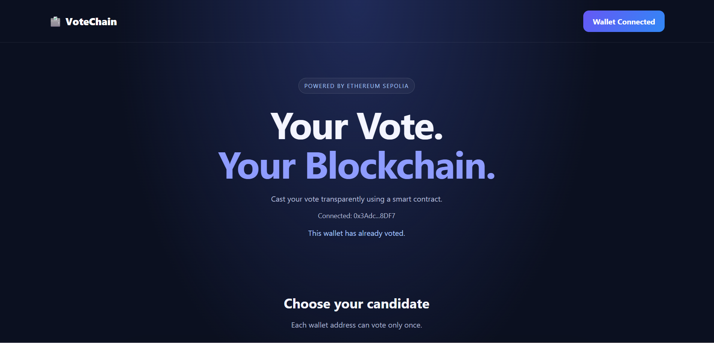
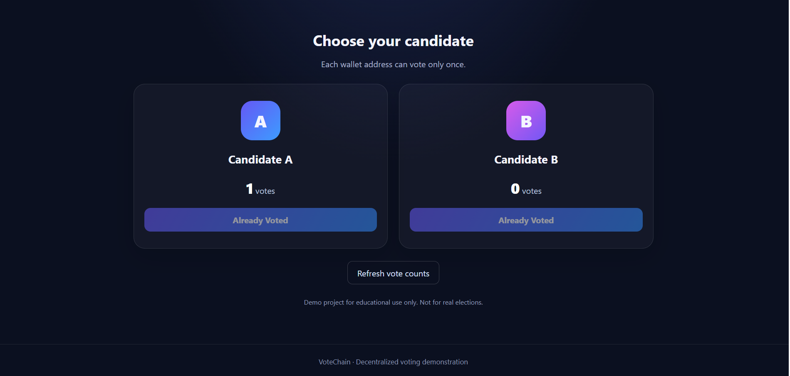

# VoteChain — Blockchain-Based Voting DApp

VoteChain is a simple decentralized voting application that uses blockchain technology to record votes transparently. It allows users to connect their Ethereum wallet, vote for a candidate, and view updated vote counts.

## Features

- **MetaMask Integration:** Connect an Ethereum wallet.
- **Blockchain Voting:** Record votes through a Solidity smart contract.
- **One Vote per Wallet:** Prevent the same wallet from voting more than once.
- **Live Vote Counts:** Display the vote totals stored on the blockchain.
- **Transaction Confirmation:** Submit votes through MetaMask.
- **Sepolia Testnet:** Deploy and test the application using the Ethereum Sepolia test network.

## Technologies Used

- Solidity — Smart contract development
- Ethereum Sepolia — Blockchain test network
- MetaMask — Wallet connection and transaction signing
- HTML, CSS, and JavaScript — Frontend development
- Ethers.js — Smart contract interaction
- Vite — Local development server

## Smart Contract

The Voting smart contract stores two candidate vote counts and tracks whether an address has already voted.

**Network:** Ethereum Sepolia Testnet

**Contract Address:** `0xAA7e18d425d918a35F365c2F52155683bBf93B79`

[View Contract on Sepolia Etherscan](https://sepolia.etherscan.io/address/0xAA7e18d425d918a35F365c2F52155683bBf93B79)

## Run Locally
## Deploy the Smart Contract

The Voting smart contract is deployed on the Ethereum Sepolia test network.

### Using Remix IDE

1. Open [Remix IDE](https://remix.ethereum.org/).
2. Create a Solidity file named `Voting.sol`.
3. Paste the VoteChain Solidity smart contract into the file.
4. Open the **Solidity Compiler** tab and select a compatible compiler version (`0.8.20` or compatible).
5. Click **Compile Voting.sol**.
6. Open **Deploy & Run Transactions**.
7. In the Environment dropdown, select **Injected Provider - MetaMask**.
8. Connect MetaMask and select the **Sepolia test network**.
9. Select the `Voting` contract and click **Deploy**.
10. Confirm the deployment transaction in MetaMask.
11. Wait for the transaction to be confirmed and copy the deployed contract address.
12. Configure the frontend to use that contract address and the correct ABI.

**Network:** Ethereum Sepolia Testnet

**Deployed Contract Address:** `0xAA7e18d425d918a35F365c2F52155683bBf93B79`

**Explorer:** https://sepolia.etherscan.io/address/0xAA7e18d425d918a35F365c2F52155683bBf93B79

*Note: Sepolia is a test network. Use test ETH, not real funds.*

### Prerequisites

- Node.js and npm
- MetaMask browser extension
- An Ethereum Sepolia testnet account with test ETH

### Installation

1. Clone the repository:

   ```bash
   git clone https://github.com/Kowsalya2882004/VoteChain.git
   ```

2. Open the project folder:

   ```bash
   cd VoteChain
   ```

3. Install the dependencies:

   ```bash
   npm install
   ```

4. Start the development server:

   ```bash
   npm run dev
   ```

5. Open the local URL displayed in the terminal.

6. Connect MetaMask and select the Sepolia test network.

## How It Works

1. The user connects their MetaMask wallet.
2. The application reads the current vote counts from the smart contract.
3. The user selects a candidate and confirms the transaction in MetaMask.
4. The smart contract validates the vote and records it on the blockchain.
5. After transaction confirmation, the updated vote count is displayed.

## Limitations

This is an educational project designed to demonstrate blockchain development and smart contract interaction. It is not suitable for real elections. One vote per wallet does not guarantee one vote per person, and the application does not implement voter identity verification or election-grade privacy.
## Application Screenshots

### VoteChain User Interface



### Voting Interface and Results




## Author

**Kowsalya**

GitHub: [@Kowsalya2882004](https://github.com/Kowsalya2882004)

---

*Developed as a blockchain voting application project for learning and demonstration purposes.*
